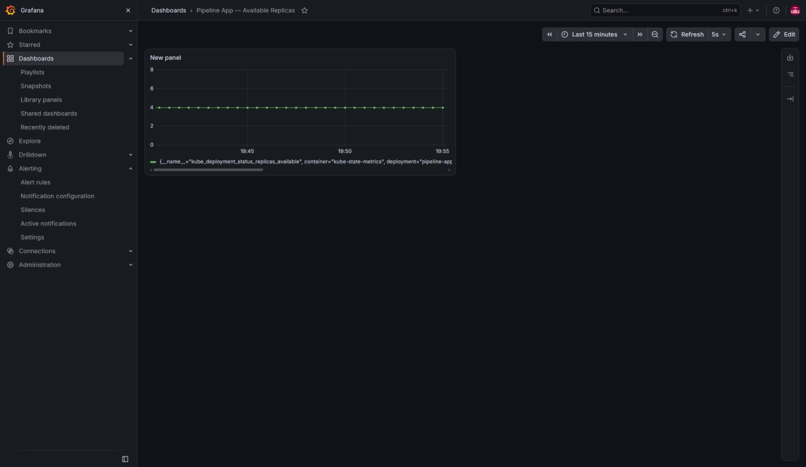
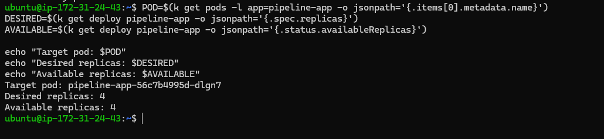
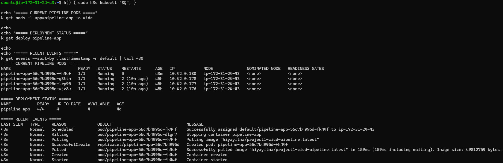
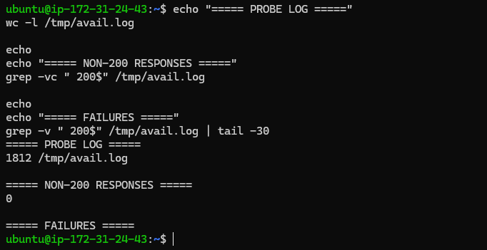
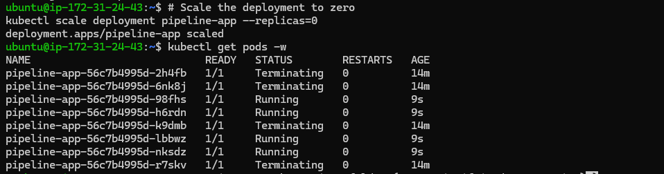

# Chaos Engineering & Resilience Validation Platform

A bounded, evidence-based chaos engineering platform that proves Kubernetes GitOps self-healing and observability alerting actually work together under real, deliberately injected failure conditions.

## 🏗️ Architecture

Fault Injected (pod kill / stress / scale-to-zero) → Observed simultaneously through Kubernetes state, Prometheus/Grafana, and Alertmanager → Recovery verified empirically.

## 🧪 Experiment 1: Pod Termination Resilience

**Hypothesis:** If a `pipeline-app` pod is terminated, Kubernetes will reschedule a replacement within ~15 seconds, and the Grafana dashboard will show at most a brief dip in available replicas — never a sustained zero.

**Blast Radius:** One pod in the default namespace.

### 1. Baseline State

Before injecting chaos, we established a steady state. The Grafana dashboard confirmed all replicas were available and healthy.

### 2. Pre-Failure Terminal State

We verified the running pods via terminal before execution to ensure a clean starting point.

### 3. Chaos Injection & Recovery

We deliberately terminated a pod. The terminal output below shows the immediate transition: the old pod enters `Terminating` while a new pod is simultaneously scheduled and reaches `Running` state.

### 4. Empirical Proof: Zero Downtime

To prove the application remained available during this swap, we ran a continuous availability probe. The results below show **1,812 requests with 0 failures**, proving the service never went down from the user's perspective.

## 🧪 Experiment 2: Multi-Pod Resilience

**Hypothesis:** Simultaneous termination of multiple pods will not cause sustained service disruption due to Kubernetes' replication controller.

**Observed Result:** Even under simultaneous termination of 2 pipeline pods, the system maintained a 100% HTTP 200 OK rate across all health-check requests.

## ️ Health Gate Verification

Before running chaos experiments, the control plane was verified to ensure no pre-existing failures would skew results. A pre-existing `CrashLoopBackOff` on the `argocd-applicationset-controller` was diagnosed (missing ApplicationSet CRD) and permanently resolved.

## 🔑 Key Learnings

- **Steady-State Hypothesis Methodology:** Chaos engineering is not "breaking things randomly." It requires stating a hypothesis, defining a bounded blast radius, and measuring the actual outcome against the expected steady state.
- **Empirical Validation over Assumption:** Trusting that "Kubernetes self-heals" is not enough. Instrumenting the cluster with Prometheus/Grafana and capturing real timestamps provides undeniable, portfolio-ready proof of system behavior.
- **Bounded Blast Radius as Safety:** Using isolated namespaces and explicit resource limits ensures experiments validate resilience without causing unbounded cluster degradation.

## ▶️ How to Reproduce

1. Ensure ArgoCD `selfHeal: true` is enabled for the target application.
2. Ensure PrometheusRule `PipelineAppPodDown` is applied to the `monitoring` namespace.
3. Trigger the failure: `kubectl delete pod <pod-name>` or `kubectl scale deployment pipeline-app --replicas=0`
4. Observe the race between ArgoCD UI (Sync History) and Alertmanager UI.

## 👨‍💻 Author

**Kiya Yilma Regasa**  
Cloud & DevOps Engineer  
 [GitHub](https://github.com/kiyayilma-dev)
